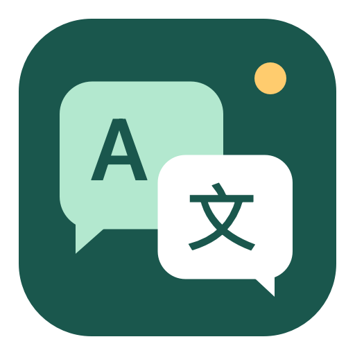

<p align="center">
  
</p>

# DawnTranslate

Mac 上的中英文沟通助手：**文字互译、邮件回复，以及 Teams／飞书的会议字幕和双向语音翻译。**

[下载安装包](https://github.com/chenguang-jiang/dawn-translate/releases/latest) · [安装说明](docs/安装说明.txt) · [密钥与隐私](docs/密钥与隐私.md)

适用于 **Apple 芯片 Mac、macOS 14 或更新版本**。当前安装包为本地临时签名，尚未经过 Apple 公证；企业管理设备可能不允许运行。

## 持续对话，只需一个入口

```text
我说中文 → 本机识别 → AI 翻译 → 英文男声 → 会议麦克风
对方说英文 → 本机识别 → AI 翻译 → 中文字幕 + 耳机中文朗读
```

选择 Teams 或飞书，点击“开始对话”。按停顿自动翻译，不必逐句切换录音、翻译和发送。会中可暂停、静音自己、关闭中文朗读；“仅字幕”模式不收自己的麦克风、不发送语音。

| 功能 | 使用方式 |
| --- | --- |
| 文字翻译 | 输入中英文，按 Enter 翻译；支持图片、PDF、Word 内容导入 |
| 邮件回复 | 粘贴来信或截图，写下回复意思，生成并编辑回复正文 |
| 会议翻译 | Teams／飞书桌面版，支持双向语音、仅字幕、浮动字幕与导出 |
| 单句翻译 | 从会议页“更多”进入，手动录音或输入，确认后发送英文 |

## 安装与首次使用

1. 从 [Releases](https://github.com/chenguang-jiang/dawn-translate/releases/latest) 下载 `.dmg`，打开后将 `DawnTranslate.app` 拖到 `Applications`。
2. 打开应用，在“设置”中填写**你自己的**模型地址、模型 ID 和 API 密钥，保存连接。
3. 首次使用语音时，按系统提示授权麦克风及“屏幕与系统音频录制”。

也提供 ZIP 版，解压后将应用放进“应用程序”。软件包含本机中英识别模型，不依赖 Python。安装包不分发 macOS 系统声音；可在“连接音频”中进入系统声音管理，下载 Daniel 增强版等声音。

### 让对方听到英文

双向语音需先安装 [BlackHole 2ch](https://existential.audio/blackhole/) 等回环设备，并戴好耳机。在应用的“连接音频”中选择通道，然后按以下方向设置：

| 位置 | 选择 |
| --- | --- |
| Mac 声音输入 | 真实麦克风 |
| Mac 声音输出 | 耳机 |
| Teams／飞书麦克风 | 与 DawnTranslate 相同的虚拟通道，取消静音 |
| Teams／飞书扬声器 | 耳机 |

“仅字幕”不需要虚拟麦克风。系统默认输出不要选择虚拟通道，以免会议声音回送。

## 模型配置与隐私

- 使用 Chat Completions 兼容接口；支持 HTTPS，或本机回环地址的 HTTP。服务地址中禁止放入密钥或查询参数。
- **源码和安装包不含作者的模型密钥或账户配置。** 你保存的密钥只进入自己 Mac 的钥匙串，不写入应用包或 Git。
- OCR 和语音识别在本机完成；提取后的文字发送给你配置的 AI 服务翻译，费用由该服务决定。本机系统声音合成不新增云端语音费。
- 对话和翻译历史保留在内存中，退出后清空；需要的记录可主动导出。录音片段仅在私有临时目录暂存，识别、取消或正常退出时清理。
- 应用不会启动时扫描其他软件的凭据。“导入本机 DeepSeek”仅在用户主动点击时尝试读取本机已有配置；该文件不会被打包。

详细说明见 [密钥与隐私](docs/密钥与隐私.md)。

## 当前边界

- 支持 Teams、飞书／Lark **桌面客户端**，暂不捕获网页会议；客户端提示音也可能被识别。
- 按句处理，存在断句、本机识别、网络和播放延迟；保留对方英文原声，中文译声随后播放。不是逐词同步的同声传译。
- 无法确认会议软件是否选对麦克风、是否静音、远端是否实际收到英文。首次请用测试通话或第二台设备检查。
- 尚未完成 Teams／飞书双方真实会议的端到端验收。不要将当前实现当作已验证的会议效果承诺。
- 邮件模板当前保留作者自用署名。使用生成结果前应核对并修改署名及内容，软件不会自动发邮件。

## 从源码构建

需要 Xcode Command Line Tools、CMake 和网络连接。首次构建会下载固定版本的 whisper.cpp 及经过 SHA-256 验证的语音模型。

```bash
bash scripts/build-app.sh
```

应用生成于 `.build/app.noindex/DawnTranslate.app`。构建目录不自动进入应用搜索，避免与正式安装重复显示。

```bash
bash scripts/package-release.sh       # 生成 DMG、ZIP 和 SHA-256 文件
bash scripts/test.sh                  # 翻译、邮件、文档与工作流检查
bash scripts/test-conversation.sh     # 双向对话队列及取消检查
bash scripts/test-speech.sh           # 合成录音上的真实本机语音识别
```

发布前使用 `scripts/check-release-secrets.py` 检查干净源码与应用包，实际密钥值不会输出到日志。`.build`、`dist`、凭据文件及内部验证记录均不进入版本控制；安装包仅作为 Release 附件分发。

## 第三方组件

本机识别使用 [whisper.cpp](https://github.com/ggml-org/whisper.cpp) 与 [Whisper 模型](https://github.com/openai/whisper)，对应许可证保留在 [docs/third-party](docs/third-party)。DawnTranslate 本身尚未另行声明开源许可。
